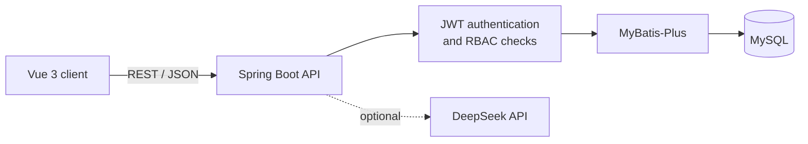

# UAS 2.0 — Role-Based Access Control Platform

<p align="center">
  
</p>

<p align="center">
  A full-stack administration platform for modeling users, roles, resources, and operation-level permissions.
</p>

<p align="center">
  
  
  
  
</p>

## Overview

UAS 2.0 is an academic full-stack implementation of role-based access control (RBAC). It brings authentication, user administration, role assignment, and granular resource-operation permissions into one coherent system. The repository includes the application, database bootstrap scripts, domain models, and interaction diagrams so that both the implementation and the design process can be reviewed.

The project also includes an optional DeepSeek-powered assistant as an exploration of how administrative systems can support natural-language help without coupling the core authorization flow to the AI service.

## What the system demonstrates

- JWT-based authentication and protected backend routes
- User lifecycle management with pagination and search
- Role creation, assignment, and deletion
- Permission modeling across roles, resources, and operations
- Centralized Axios request handling and route guards
- A responsive Vue and Element Plus administration interface
- Optional natural-language assistant integration
- Database, domain, use-case, activity, and sequence modeling

## Architecture



The permission model separates the entities that usually become conflated in smaller demos:

```text
User → Role → Resource (menu) × Operation
```

This structure allows a role to receive a specific operation on a specific resource rather than relying only on page-level access.

## Technology

| Layer | Main technologies |
| --- | --- |
| Frontend | Vue 3, Vite, Vue Router, Pinia, Element Plus, Axios |
| Backend | Java 17, Spring Boot, MyBatis-Plus, JJWT |
| Data | MySQL, relational RBAC schema |
| Optional integration | DeepSeek chat API |
| Design artifacts | ER, UML/domain, use-case, activity, and sequence diagrams |

## Repository map

```text
.
├── UAS2.0/
│   ├── authority-frontend/   # Vue administration client
│   ├── authority-backend/    # Spring Boot REST API
│   └── Scripts/              # Primary database bootstrap scripts
├── graphs/                   # System and interaction diagrams
├── resources/                # Project visual identity
├── dataBaseScripts/          # Earlier database design material
└── 界面原型/                  # Interface prototype source
```

## Run locally

### Prerequisites

- Java 17
- Node.js 20 or later
- MySQL 8
- Maven 3.9+, or the included Maven wrapper

### 1. Initialize MySQL

Run the schema script:

```bash
mysql -u root -p < UAS2.0/Scripts/databaseInitialize.sql
```

The script creates the `authority_sys` database and a small set of development records. The seeded credentials are intentionally for local demonstration only and must not be reused in a deployed environment.

### 2. Configure and start the backend

Set the required environment variables before starting the service:

| Variable | Purpose | Example |
| --- | --- | --- |
| `DB_URL` | JDBC connection URL | `jdbc:mysql://localhost:3306/authority_sys?...` |
| `DB_USERNAME` | MySQL account | `auth_dev` |
| `DB_PASSWORD` | MySQL password | local value |
| `JWT_SECRET` | JWT signing secret, at least 32 characters | randomly generated value |
| `DEEPSEEK_API_KEY` | Optional assistant integration | provider API key |
| `CORS_ALLOWED_ORIGINS` | Comma-separated frontend origins | `http://localhost:5173` |

On PowerShell:

```powershell
$env:DB_USERNAME = "auth_dev"
$env:DB_PASSWORD = "<your-local-password>"
$env:JWT_SECRET = "<a-random-secret-of-at-least-32-characters>"
cd UAS2.0/authority-backend
.\mvnw.cmd spring-boot:run
```

The API starts at `http://localhost:8080`.

### 3. Configure and start the frontend

```bash
cd UAS2.0/authority-frontend
cp .env.example .env
npm install
npm run dev
```

Open the URL printed by Vite. The default API address is `http://localhost:8080` and can be changed through `VITE_API_BASE_URL`.

## Design documentation

The repository keeps design evidence next to the code:

- [Entity–relationship diagram](graphs/ER_Diagram.png)
- [Use-case diagram](graphs/UseCase_Diagram.png)
- [Domain class diagram](graphs/领域类图.png)
- [Activity diagrams](graphs/)
- [Sequence diagrams](graphs/)

## Security scope

This repository is a course-oriented implementation intended to demonstrate system design and authorization flow. Runtime secrets are read from environment variables and are not committed in the current source tree. Before any production use, replace the development seed data, hash passwords with an adaptive algorithm such as Argon2 or bcrypt, add rate limiting and audit logging, and review authorization rules for every mutating endpoint.
